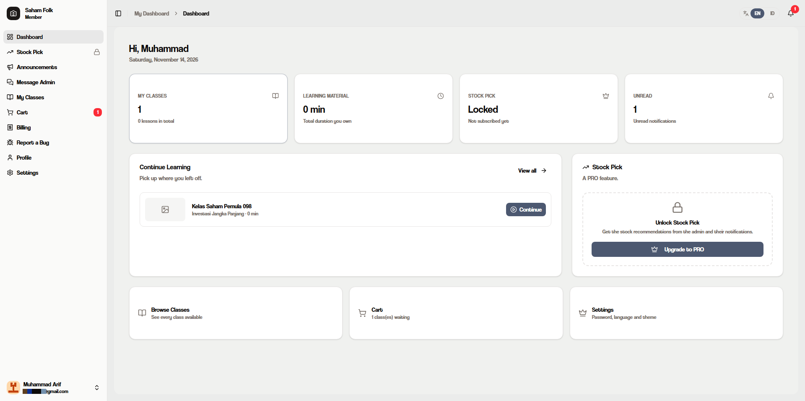
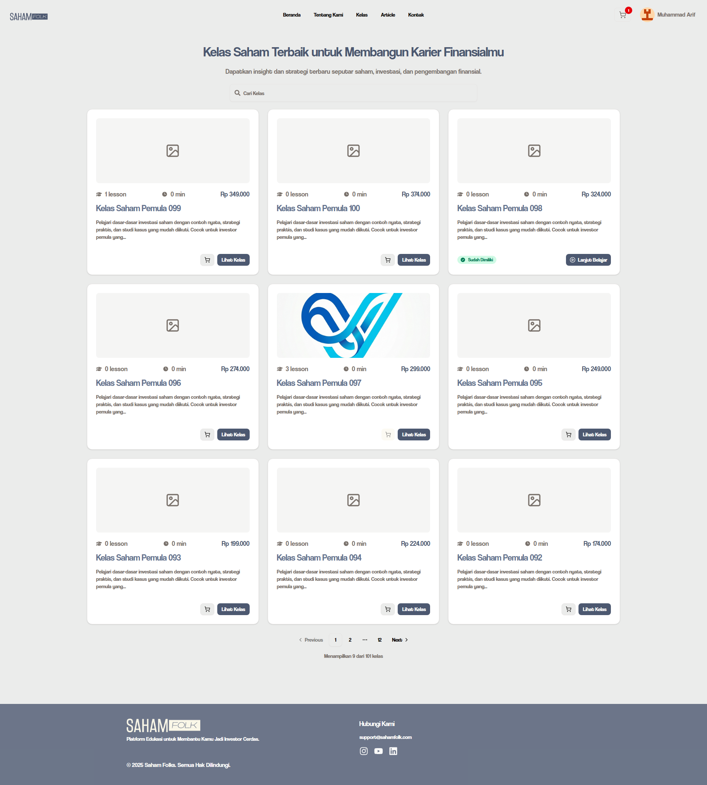

# saham-folk-case-study

Case study: React + Django REST Framework app with Midtrans payments and PDF invoices
Full-stack web application built by a small team (Jul 2025 – Sep 2026).

**The source code is private** because it is a team project. This repo explains what the app does and what I built. I'm happy to walk through the code on a call.




## What is Saham Folk?

Saham Folk is a online stock-investing education platform: video classes, stock pick recommendations, and educational articles, with a member dashboard and an admin panel.

## Tech stack

| Layer      | Technology                                      |
| ---------- | ----------------------------------------------- |
| Frontend   | React, Vite, JavaScript                         |
| Backend    | Python, Django, Django REST Framework           |
| Payments   | Midtrans (Snap checkout, payment notifications) |
| Documents  | Generated PDF invoices                          |
| Deployment | Linux server / web hosting                      |

## Architecture

```
React (Vite) SPA  ──REST/JSON──▶  Django REST Framework API  ──▶  Database
                                        │
                                        ├──▶ Midtrans (create transaction, receive payment notification)
                                        └──▶ PDF invoice generator
```

## My contributions

- **Frontend ↔ backend integration:** connected React pages to the DRF API (auth, data fetching, error states).
- **Payments:** built the Midtrans checkout for **course purchases and subscriptions**, including handling the payment status that Midtrans sends back after a transaction.
- **Invoices:** generated a **PDF invoice** automatically after a successful payment.
- **Backend & deployment:** helped with backend configuration (settings, environment variables) and deployed the application to production hosting.

## Payment flow

```
User clicks "Buy" ─▶ API creates order + Midtrans transaction ─▶ user pays in Midtrans Snap
      ─▶ Midtrans sends notification to API ─▶ order marked "paid" ─▶ PDF invoice generated ─▶ access unlocked
```

## Screenshots

| Course page | Checkout | Checkout (Midtrans sandbox) | invoice | PDF invoice | invoice in email | Access Unclocked
|  |  |  |  |  |  |  |

## Code samples (my own work)

For example the DRF view that creates the Midtrans transaction, and the invoice function.

|  |

## What I learned

- Designing a payment flow that stays correct when the user closes the tab: the server trusts Midtrans' notification, not the browser.
- Working in a shared codebase: splitting work, reviewing changes, and keeping frontend and backend contracts in sync.
- Taking an app from local development to a running production deployment.

---

Muhammad Arif · [GitHub](https://github.com/muharifs) · [LinkedIn](https://www.linkedin.com/in/muhammad-arif-59221531a/)
