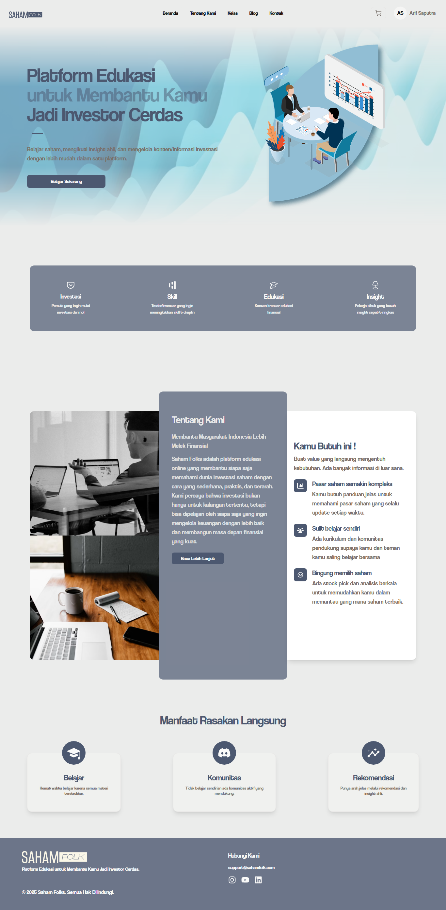
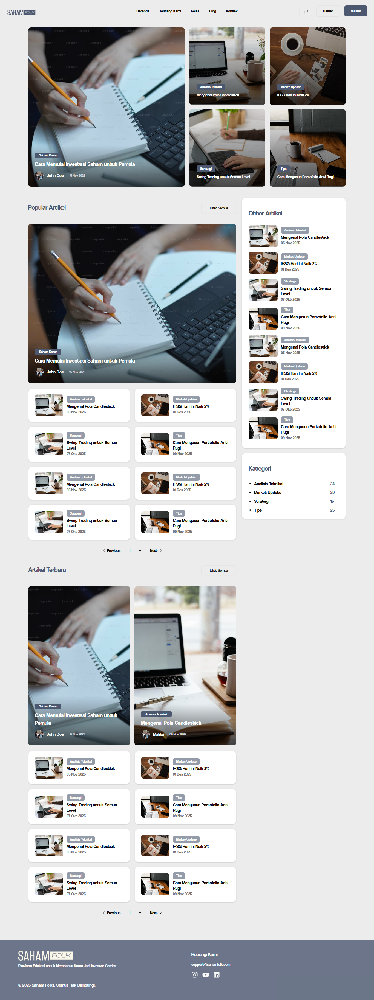
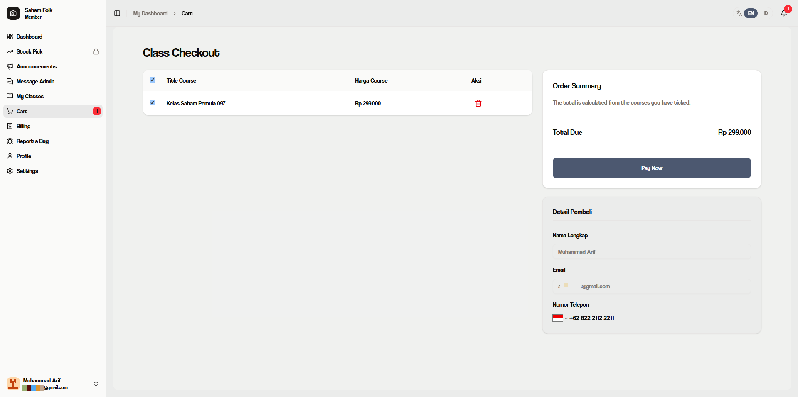
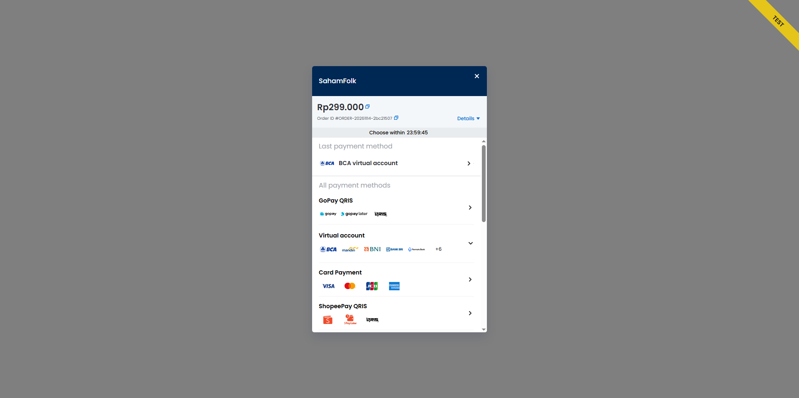
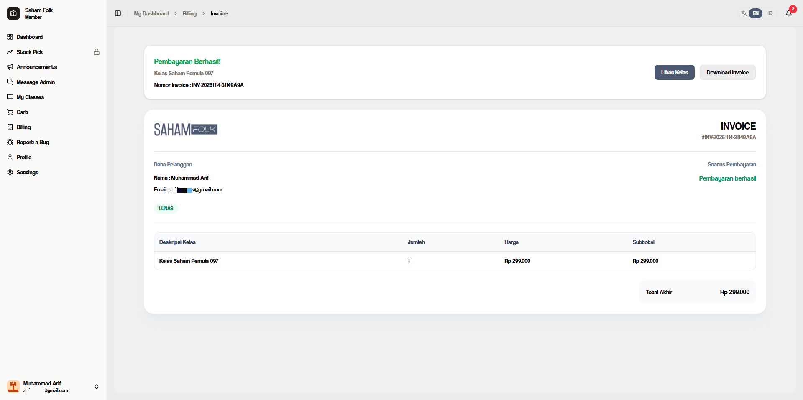
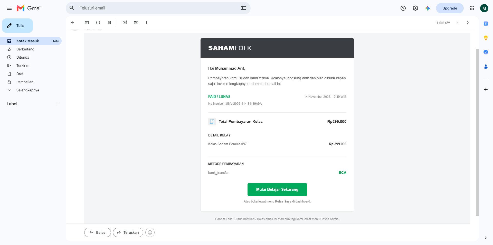
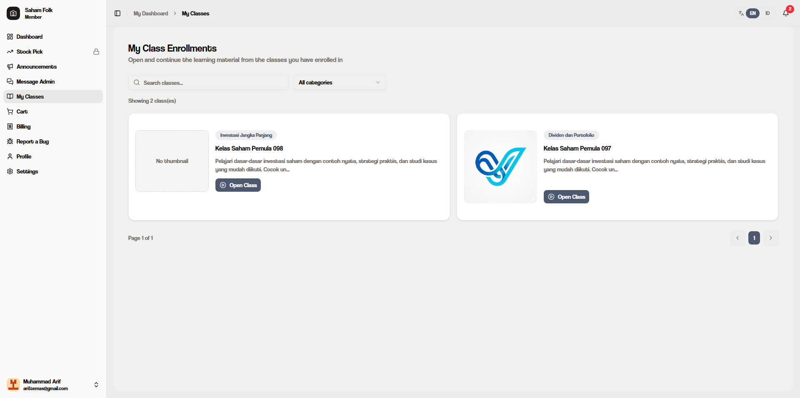

# saham-folk-case-study

Case study: React + Django REST Framework app with Midtrans payments and PDF invoices
Full-stack web application built by a small team (Jul 2025 – Sep 2026).

**The source code is private** because it is a team project. This repo explains what the app does and what I built. I'm happy to walk through the code on a call.





## What is Saham Folk?

Saham Folk is a online stock-investing education platform: video classes, stock pick recommendations, and educational articles, with a member dashboard and an admin panel.

## Tech stack

| Layer      | Technology                                      |
| ---------- | ----------------------------------------------- |
| Frontend   | React, Vite, JavaScript                         |
| Backend    | Python, Django, Django REST Framework           |
| Payments   | Midtrans (Snap checkout, payment notifications) |
| Documents  | Generated PDF invoices                          |
| Deployment | Linux server / web hosting                      |

## Architecture

```
React (Vite) SPA  ──REST/JSON──▶  Django REST Framework API  ──▶  Database
                                        │
                                        ├──▶ Midtrans (create transaction, receive payment notification)
                                        └──▶ PDF invoice generator
```

## My contributions

- **Frontend ↔ backend integration:** connected React pages to the DRF API (auth, data fetching, error states).
- **Payments:** built the Midtrans checkout for **course purchases and subscriptions**, including handling the payment status that Midtrans sends back after a transaction.
- **Invoices:** generated a **PDF invoice** automatically after a successful payment.
- **Backend & deployment:** helped with backend configuration (settings, environment variables) and deployed the application to production hosting.

## Payment flow

```
User clicks "Buy" ─▶ API creates order + Midtrans transaction ─▶ user pays in Midtrans Snap
      ─▶ Midtrans sends notification to API ─▶ order marked "paid" ─▶ PDF invoice generated ─▶ access unlocked
```

## Screenshots

| Course page | Checkout | Checkout (Midtrans sandbox) | invoice | PDF invoice | invoice in email | Access Unclocked
|  |  |  |  |  |  |  |

## Code samples (my own work)

For example the DRF view that creates the Midtrans transaction, and the invoice function.

```python
@api_view(["POST"])
@permission_classes([IsAuthenticated])
def course_checkout(request):
    try:
        request_data = json.loads(request.body)
    except (json.JSONDecodeError, UnicodeDecodeError):
        return Response(
            {"success": False, "message": "Format permintaan tidak valid."},
            status=status.HTTP_400_BAD_REQUEST,
        )
    if not isinstance(request_data, dict):
        return Response(
            {"success": False, "message": "Format permintaan tidak valid."},
            status=status.HTTP_400_BAD_REQUEST,
        )
    user = request.user

    # Admin accounts manage the catalogue, they never buy from it. Enforced here
    # (not only in the UI) so re-enabling the button in devtools changes nothing.
    if user.is_staff or user.is_superuser:
        return Response(
            {
                "success": False,
                "message": "Akun admin tidak dapat melakukan checkout kelas.",
            },
            status=status.HTTP_403_FORBIDDEN,
        )

    user_profile = UserProfile.objects.filter(user=user).first()
    if user_profile is None:
        return Response(
            {"success": False, "message": "Profil pengguna belum lengkap."},
            status=status.HTTP_400_BAD_REQUEST,
        )

    items_array = request_data.get('items', [])
    if not isinstance(items_array, list) or not items_array:
        return Response(
            {"success": False, "message": "Tidak ada item yang dipilih."},
            status=status.HTTP_400_BAD_REQUEST,
        )

    list_course_id = [
        item.get('course_id')
        for item in items_array
        if isinstance(item, dict) and item.get('course_id') is not None
    ]
    # Only published courses are for sale. Without this filter a client could
    # name the id of a draft or hidden course and buy it.
    course_db = Course.objects.filter(id__in=list_course_id, status='published')
    course_lookup = {course.id: course for course in course_db}

    # Unknown or unpublished ids used to be skipped silently, which left an
    # empty, zero-amount order on its way to Midtrans.
    if len(course_lookup) != len(set(list_course_id)):
        return Response(
            {"success": False, "message": "Ada kelas yang tidak tersedia untuk dibeli."},
            status=status.HTTP_400_BAD_REQUEST,
        )

    # Refuse to sell a class the buyer already owns.
    already_owned = set(
        Enrollment.objects.filter(
            user=user, course_id__in=course_lookup.keys()
        ).values_list('course_id', flat=True)
    )
    if already_owned:
        titles = [course_lookup[cid].title for cid in already_owned if cid in course_lookup]
        return Response(
            {
                "success": False,
                "message": "Kelas ini sudah kamu miliki: " + ", ".join(titles),
            },
            status=status.HTTP_400_BAD_REQUEST,
        )
    list_order = []
    item_details = []

    discount_amount = Decimal("0.00")
    total_amount = Decimal("0.00")

    for item in items_array:
        course_id = item.get('course_id')
        if not course_id:
            continue

        course = course_lookup.get(course_id)
        if not course:
            continue

        # A class is bought once; anything the client sends is clamped to 1 so
        # a crafted quantity cannot inflate or bypass the order total.
        quantity = 1

        unit_price = Decimal(str(course.price))
        line_total = unit_price * quantity
        total_amount += line_total

        orderdetail = OrderItem(
            order=None,
            course=course,
            original_price=course.price,
            quantity=quantity,
            discount_amount=discount_amount,
            subtotal=int(line_total),
        )
        list_order.append(orderdetail)

        item_details.append({
            "id": f"Kelas-{course.id}",
            "price": int(unit_price),
            "quantity": quantity,
            "name": course.title,
            "category": "Course",
        })

    if not list_order:
        return Response(
            {"success": False, "message": "Tidak ada item yang bisa diproses."},
            status=status.HTTP_400_BAD_REQUEST,
        )

    if total_amount < 0:
        total_amount = Decimal("0.00")

    # Create Order
    order_id = f"ORDER-{timezone.now():%Y%m%d}-{uuid.uuid4().hex[:8]}"
    order = Order.objects.create(
        user=user,
        order_id_midtrans=order_id,
        global_discount=discount_amount,
        total_amount=total_amount,
        status="pending"
    )

    for index, orderdetail in enumerate(list_order):
        orderdetail.order = order
        list_order[index] = orderdetail

    if list_order:
        OrderItem.objects.bulk_create(list_order)

    Payment.objects.create(
        order=order,
        gross_amount=total_amount,
        transaction_status="pending"
    )

    snap = midtransclient.Snap(
        # Set to true if you want Production Environment (accept real transaction).
        is_production=settings.MIDTRANS_IS_PRODUCTION,
        server_key=settings.MIDTRANS_SERVER_KEY,
        client_key=settings.MIDTRANS_CLIENT_KEY,
    )

    gross_amount_value = int(total_amount.quantize(Decimal("1")))
    if gross_amount_value < 1:
        gross_amount_value = 1

    param = {
        "transaction_details": {
            "order_id": order.order_id_midtrans,
            "gross_amount": gross_amount_value,
        },
        "customer_details": {
            "first_name": user_profile.full_name,
            "email": user.email,
            "phone": user_profile.phone,
        },
        "item_details": item_details,
    }

    transaction = snap.create_transaction(param)
    transaction_token = transaction["token"]

    return Response(
        {
            "success": True,
            "data": {
                "snap_token": transaction_token,
                "gross_amount": gross_amount_value,
                "order_id": order.id,
            },
        },
        status=status.HTTP_200_OK,
    )

class InvoiceViewSet(ReadOnlyModelViewSet):
"""A buyer's own invoices. Read-only: invoices are issued by the payment
flow, never edited or deleted over the API."""

    permission_classes = [IsAuthenticated]
    serializer_class = InvoiceSerializer

    lookup_field = 'order__order_id_midtrans'
    lookup_url_kwarg = 'order_id_midtrans'

    def get_queryset(self):
        """Scope every action to the caller. Without this the viewset served
        every customer's name, email and payment total to anyone logged in."""
        qs = Invoice.objects.select_related('order', 'order__user')
        user = self.request.user
        if user.is_staff or user.is_superuser:
            return qs
        return qs.filter(order__user=user)

    @action(detail=False, methods=['get'], url_path=r'(?P<invoice_number>[^/.]+)/download-pdf')
    def download_invoice(self, request, invoice_number=None):
        mode = request.GET.get('mode')
        invoice = get_object_or_404(Invoice, invoice_number=invoice_number)

        # An invoice is one person's receipt: only the buyer and staff.
        user = request.user
        if not (user.is_staff or user.is_superuser) and invoice.order.user_id != user.id:
            return Response(
                {'error': 'Invoice tidak ditemukan.'},
                status=status.HTTP_404_NOT_FOUND,
            )

        if mode == 'html':
            profile = getattr(
                getattr(invoice.order.user, 'profile', None), 'full_name', None
            )
            return render(request, 'invoice_template.html', {
                'invoice': {
                    'invoice_number': invoice.invoice_number,
                    'id': invoice.id,
                    'buyer_name': (
                        invoice.buyer_name
                        or profile
                        or invoice.order.user.get_full_name()
                        or invoice.order.user.username
                    ),
                    'buyer_email': invoice.buyer_email or invoice.order.user.email,
                    'order': {'status': invoice.order.status},
                    'total': invoice.price_paid,
                    'price_paid': invoice.price_paid,
                    'payment_method': invoice.payment_method,
                },
                'tableRows': invoice.items or [],
                'logo_path': brand_logo_data_uri(),
            })

        pdf_file = render_invoice_pdf(invoice)
        if pdf_file is None:
            return Response(
                {'error': 'Gagal membuat PDF invoice.'},
                status=status.HTTP_500_INTERNAL_SERVER_ERROR,
            )

        response = HttpResponse(pdf_file, content_type='application/pdf')
        response['Content-Disposition'] = f'attachment; filename="Invoice_{invoice_number}.pdf"'

        return response
```

## What I learned

- Designing a payment flow that stays correct when the user closes the tab: the server trusts Midtrans' notification, not the browser.
- Working in a shared codebase: splitting work, reviewing changes, and keeping frontend and backend contracts in sync.
- Taking an app from local development to a running production deployment.

---

Muhammad Arif · [GitHub](https://github.com/muharifs) · [LinkedIn](https://www.linkedin.com/in/muhammad-arif-59221531a/)
